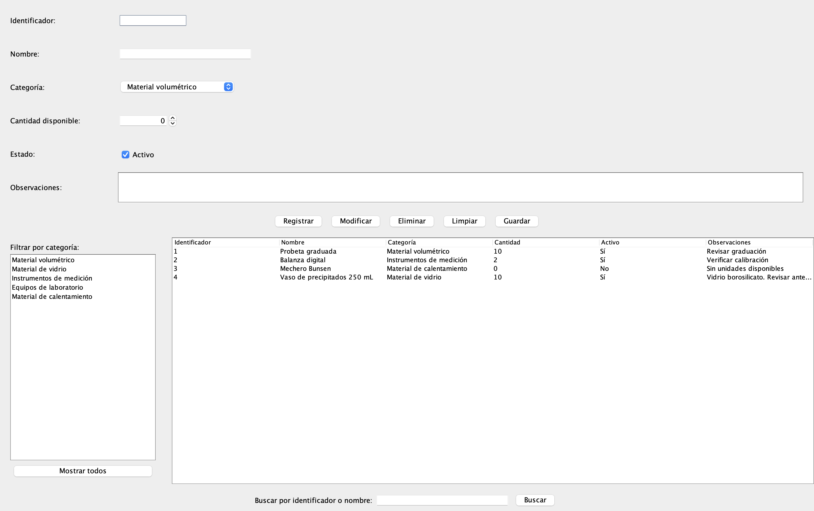

# ChemLab - Sistema de gestión de recursos de un laboratorio de química

Trabajo de Programación 2 del CeRP del Suroeste, modalidad semipresencial.
Docente: Domingo Pérez. Año: 2026.

## Integrantes

- Nicolás Monfort
- Jorge Álvarez

## Estado del proyecto

Partimos del prototipo docente de un gestor de registros en Java y Swing,
organizado con MVC, fachada y persistencia en JSON.


ChemLab es una aplicación de escritorio desarrollada en Java Swing para gestionar materiales de un laboratorio de química.

Actualmente permite registrar, modificar, eliminar, buscar y guardar materiales. Cada registro incluye identificador, nombre, categoría, cantidad disponible, estado y observaciones.

La interfaz incorpora controles de validación, selección de registros desde una tabla y filtrado por categorías mediante JList. También permite recuperar el listado completo con el botón "Mostrar todos".

La información se almacena en un archivo JSON.


La [consigna del laboratorio](docs/letra.md) detalla los requisitos del trabajo.

## Problema y destinatarios

Los laboratorios de química utilizan diferentes materiales y equipos que necesitan ser registrados y organizados. La falta de un registro centralizado dificulta conocer qué materiales están disponibles y cuáles se encuentran fuera de servicio.

ChemLab busca facilitar esta tarea mediante una aplicación destinada a las personas encargadas de administrar los recursos de un laboratorio de química.

## Utilidad de la solución

ChemLab permite registrar los materiales y equipos de un laboratorio de química, consultar sus características, modificar sus datos, eliminarlos y buscarlos de manera sencilla.

La aplicación facilita el control de los recursos disponibles y permite guardar la información en un archivo JSON mediante el botón «Guardar». Los cambios no se guardan automáticamente al cerrar el programa.

## Vista de la aplicación

<p align="center">
  
</p>

## Adaptación del modelo y reglas

ChemLab adapta el sistema de registros proporcionado por el docente para gestionar materiales y equipos de un laboratorio de química.

Cada registro contiene seis atributos:

- **Identificador:** número único que permite distinguir cada material.
- **Nombre:** denominación del material o equipo.
- **Categoría:** clasificación según su función en el laboratorio.
- **Cantidad:** número de unidades disponibles.
- **Estado:** indica si el material se encuentra activo o inactivo.
- **Observaciones:** información adicional sobre el material, como su estado de conservación o necesidades de mantenimiento.

### Categorías de materiales

Se establecen cinco categorías: material volumétrico, material de vidrio, instrumentos de medición, equipos de laboratorio y material de calentamiento.

### Reglas y validaciones

Para garantizar la coherencia de los registros, se establecen las siguientes condiciones:

1. El identificador debe ser positivo y único.
2. El nombre es obligatorio y no puede estar vacío.
3. La categoría debe corresponder a una de las categorías establecidas.
4. La cantidad debe ser un número entero igual o mayor que cero.
5. Un material sin unidades disponibles no puede figurar como activo.
6. Las observaciones son opcionales.

La regla específica del laboratorio establece que, cuando la cantidad de un material llega a cero, su estado debe cambiar a inactivo.

Estas reglas forman parte del diseño de ChemLab. Las validaciones comprobadas se detallan en la sección «Pruebas de nuestro desarrollo».

## Componentes gráficos

La interfaz de ChemLab utiliza ocho tipos de componentes gráficos de Java Swing, cada uno con una función específica.

### Componentes del proyecto original

| Componente | Función |
|---|---|
| JTextField | Introducir identificadores, nombres y criterios de búsqueda. |
| JComboBox | Seleccionar la categoría del material. |
| JCheckBox | Indicar si un material está activo o inactivo. |
| JButton | Ejecutar las operaciones de registro, modificación, eliminación, búsqueda y guardado. |
| JTable | Mostrar los materiales registrados y permitir seleccionarlos. |

### Componentes adicionales


| Componente | Función | Estado |
|---|---|---|
| JTextArea | Registrar observaciones sobre los materiales. | Implementado. |
| JSpinner | Gestionar la cantidad disponible mediante un control numérico. | Implementado. |
| JList | Filtrar los materiales por categoría y recuperar el listado completo mediante el botón "Mostrar todos". | Implementado. |

Los tres componentes adicionales están incorporados a la interfaz de ChemLab.


## Organización de paquetes y recorrido de una operación

| Paquete o carpeta | Responsabilidad |
| --- | --- |
| [app](src/main/java/app) | Iniciar la aplicación y conectar los objetos. |
| [modelo](src/main/java/modelo) | Representar los materiales y aplicar sus reglas básicas. |
| [vista](src/main/java/vista) | Mostrar la interfaz Swing y los mensajes. |
| [controlador](src/main/java/controlador) | Recibir eventos y coordinar las acciones mediante la fachada. |
| [fachada](src/main/java/fachada) | Ofrecer operaciones y coordinar el modelo con la persistencia. |
| [persistencia](src/main/java/persistencia) | Leer y escribir JSON, sin depender de Swing. |
| [datos](datos) | Contener el archivo JSON; no es un paquete Java. |

Durante la carga inicial de ChemLab se sigue este recorrido:
[Aplicacion](src/main/java/app/Aplicacion.java) conecta los objetos;
el controlador solicita la carga a la fachada; la fachada utiliza la
persistencia para leer el archivo; y el controlador entrega los registros a la
vista para mostrarlos en la tabla. La vista no lee ni escribe archivos.

Cuando el usuario pulsa Registrar, el controlador recibe la operación y la comunica a la fachada. Esta valida los datos y agrega el material al listado. La interfaz actualiza la tabla para mostrar el nuevo registro.

Al pulsar Guardar, la fachada utiliza la capa de persistencia para almacenar los registros en el archivo datos/registros.json. Así, la información puede recuperarse al volver a ejecutar ChemLab.

## Instrucciones de ejecución

### Requisitos

- JDK 25 LTS o superior, con `JAVA_HOME` apuntando al JDK y su carpeta `bin`
  en el `PATH`, para disponer de los comandos `java` y `javac`.
- Windows, macOS o Linux con un entorno gráfico para mostrar Swing.
- Git, si se descarga el proyecto mediante clonación.
- Conexión a Internet en la primera ejecución para descargar Maven y las
  dependencias. La aplicación utiliza un archivo local, sin base de datos ni
  conexión a Internet durante su uso.

No es necesario instalar Maven ni agregarlo al `PATH`: el repositorio incluye
Maven Wrapper, que descarga y utiliza Maven 3.9.11 automáticamente.
La compilación genera clases para Java 25; no se pueden ejecutar con Java 17
ni Java 21. Maven Wrapper utiliza el JDK indicado por `JAVA_HOME`.

Después de instalar o cambiar el JDK, reiniciar la terminal y VS Code.
Comprobar que `java -version`, `javac -version` y `.\mvnw.cmd -version`
(Windows) o `sh mvnw -version` (macOS y Linux) indiquen Java 25 o superior.

### Descargar el proyecto

```text
git clone https://github.com/septimodecaballeria/prog2-lab2026-monfort_alvarez.git
cd prog2-lab2026-monfort_alvarez
```

El nombre del repositorio debe seguir el formato indicado en la consigna:
`prog2-lab2026-apellido1_apellido2`.

Ejecutar los siguientes comandos desde la raíz del proyecto, donde se
encuentra [pom.xml](pom.xml).

### Windows: PowerShell

```powershell
.\mvnw.cmd compile exec:java
```

Para compilar sin abrir la ventana:

```powershell
.\mvnw.cmd compile
```

Si aparece «mvn no se reconoce», utilizar `.\mvnw.cmd` como en los comandos
anteriores. El prefijo `.\` indica a PowerShell que ejecute el lanzador de la
carpeta actual.

### macOS y Linux: terminal

```sh
sh mvnw compile exec:java
```

Para compilar sin abrir la ventana:

```sh
sh mvnw compile
```

Al utilizar `sh mvnw` no es necesario cambiar los permisos del archivo.
En Linux se requiere una sesión de escritorio; una terminal de servidor sin
entorno gráfico no puede mostrar la ventana.

### VS Code y dependencias

Abrir la carpeta raíz con Extension Pack for Java instalado e importar el
proyecto Maven. También se puede ejecutar el método `main` de
[Aplicacion](src/main/java/app/Aplicacion.java), con la raíz del proyecto como
directorio de trabajo.
En `Java: Configure Java Runtime`, seleccionar un JDK 25 para este proyecto.
La configuración local de VS Code selecciona el JDK 25 instalado en
`%USERPROFILE%\.jdks\jdk-25.0.4.1+1` para las terminales de Windows y el
proyecto Java, sin modificar el `PATH` del sistema. Si se utiliza otra
instalación, ajustar las rutas en `.vscode/settings.json`.

La biblioteca de persistencia es Gson 2.13.2. Está declarada, junto con los
complementos de compilación y ejecución, en [pom.xml](pom.xml).

### Archivo de datos

El archivo de ejemplo es [datos/registros.json](datos/registros.json).
La ruta es relativa al directorio desde el cual se inicia la aplicación.

Si el archivo no existe, la aplicación inicia con una lista vacía. Si es
inválido o ilegible, muestra un error y mantiene la ventana abierta sin
reemplazarlo. La fachada bloquea el guardado cuando la carga no fue correcta.


El botón "Guardar" permite almacenar los registros en el archivo JSON. Al cerrar la ventana, los cambios no se guardan automáticamente.


## Pruebas realizadas y limitaciones conocidas

### Comprobaciones heredadas del prototipo

La base fue verificada en Windows con OpenJDK 17.0.17 y Maven 3.9.11.
Es compatible por diseño con macOS y Linux, pero su ejecución en esos sistemas
todavía no fue comprobada.

Tras actualizar a Java 25 LTS, se verificó en Windows con Eclipse Temurin
25.0.4.1 y Maven 3.9.11 la compilación limpia mediante `.\mvnw.cmd clean verify`.
También se comprobaron la carga de los tres registros de ejemplo, la lectura
sin archivo, la escritura y lectura JSON con tildes, la copia del listado,
el rechazo de JSON inválido y el bloqueo del guardado tras una carga fallida.
No hay pruebas automatizadas en el repositorio; estas comprobaciones se
realizaron con un programa temporal. La interfaz gráfica no se volvió a
verificar como parte de esta actualización.

| Acción | Resultado esperado | Resultado obtenido en la base |
| --- | --- | --- |
| Compilar mediante Maven Wrapper en Windows. | Compilación sin errores. | Correcto. |
| Abrir la aplicación desde la raíz. | Mostrar los tres registros del JSON. | Correcto. |
| Pulsar los seis botones. | Mostrar avisos de funcionalidad pendiente sin modificar datos. | Correcto. |
| Iniciar sin JSON, con una ruta de prueba. | Mostrar la tabla vacía sin crear el archivo. | Correcto. |
| Iniciar con JSON inválido, usando una copia de prueba. | Informar el error sin cerrar la ventana ni modificar el archivo. | Correcto. |
| Leer y escribir registros en un archivo temporal. | Recuperar todos los atributos, incluidos caracteres con tildes. | Correcto. |
| Guardar desde la fachada tras una carga fallida. | Rechazar el guardado sin reemplazar el archivo. | Correcto. |

### Pruebas de nuestro desarrollo

La versión actual de ChemLab también fue ejecutada y comprobada en macOS, utilizando Visual Studio Code y Java Swing.

*Pruebas realizadas:** se comprobaron manualmente las principales funciones de ChemLab. Los resultados obtenidos se detallan en la siguiente tabla.

| Acción | Resultado esperado | Resultado obtenido |
| --- | --- | --- |
| Crear un registro válido. | Aparece en el listado con identificador único. | Comprobado: se registró correctamente el vaso de precipitados con identificador 4. |
| Registrar un material con identificador repetido. | Rechazar el registro e informar el error. | Comprobado: ChemLab muestra "Ya existe un material con ese identificador" y no duplica el registro. |
| Registrar un material sin nombre. | Rechazar el registro e informar el error. | Comprobado: ChemLab muestra "El nombre es obligatorio" y no permite registrar el material. |
| Registrar un material con cantidad cero y estado activo. | Rechazar la operación e informar el motivo. | Comprobado: ChemLab rechaza un material con cantidad cero si está activo y permite registrarlo si está inactivo. |
| Modificar un registro seleccionado. | Actualizarlo conservando su identificador, sin duplicarlo. | Comprobado: se modificaron las observaciones del vaso de precipitados, conservando su identificador 4 y los demás datos. |
| Cancelar y confirmar la eliminación de un material. | Conservar el registro si se cancela y eliminarlo si se confirma. | Comprobado: se eliminó el termómetro de laboratorio y se conservó el vaso de precipitados al cancelar su eliminación. |
| Buscar materiales y filtrar por categoría. | Mostrar únicamente los registros que cumplen el criterio. | Comprobado: funcionan las búsquedas por identificador exacto y por nombre, así como el filtrado por categoría mediante JList. |
| Limpiar el formulario. | Dejarlo preparado para una nueva operación. | Comprobado: limpia los campos y recupera el listado completo. |
| Crear y modificar datos, guardar, cerrar y volver a abrir. | Recuperar los cambios desde el JSON. | Comprobado: se registró y modificó un material, se guardaron los cambios y se recuperaron correctamente al reiniciar ChemLab. |
| Iniciar sin JSON y con JSON inválido. | Manejar correctamente la ausencia de datos y los errores de lectura. | Comprobado: sin JSON, ChemLab inicia con la tabla vacía; con JSON inválido, muestra un mensaje de error. Al restaurar el archivo original, recupera los cuatro materiales. |

Las principales funciones de ChemLab fueron implementadas y comprobadas mediante pruebas manuales. Queda pendiente preparar y publicar el video explicativo.

## Procedencia del código y recursos utilizados

- **Base docente:** prototipo inicial en Java con arquitectura MVC, fachada, modelo de registros, interfaz Swing, carga de ejemplos, persistencia JSON y configuración Maven Wrapper. El prototipo incluía funcionalidades pendientes que posteriormente desarrollamos.
- **Trabajo de nuestro equipo:** adaptación de la persistencia JSON, puesta en funcionamiento de los botones de gestión, incorporación de JSpinner para gestionar cantidades, JList para filtrar materiales por categoría, mejoras de la interfaz gráfica y corrección de la búsqueda por identificador y nombre.
- **Bibliotecas:** Gson 2.13.2 para leer y escribir JSON; Swing, incluido en Java,
  para la interfaz.
- **Herramientas de IA:** se utilizó ChatGPT como apoyo para revisar código Java, resolver errores, mejorar la interfaz gráfica y organizar la documentación. Las funcionalidades fueron comprobadas manualmente.

## Aportes de cada integrante

| Integrante | Aportes realizados |
| --- | --- |
| Nicolás Monfort || Nicolás Monfort | Adaptación del modelo de registros para gestionar materiales de laboratorio mediante seis atributos y reglas de validación; implementación de las operaciones de registro, modificación, eliminación y búsqueda mediante la fachada y el controlador; integración de la persistencia JSON y manejo de errores de carga y guardado; desarrollo de la interfaz Swing y sus validaciones; pruebas funcionales y de persistencia.
Comprobación de las siguientes funciones:
Registrar un material	Correcto
Modificar un material sin cambiar su identificador	Correcto
Cancelar una eliminación	Correcto
Confirmar una eliminación	Correcto
Guardar los datos	Correcto
Recuperar cambios después de reiniciar	Correcto
Prueba de validación de identificador duplicado en ChemLab: Correcto
Prueba de validación de nombre obligatorio en ChemLab: Correcto
Prueba de regla de dominio cantidad cero y estado activo en ChemLab: Correcto
Prueba de búsqueda por nombre: Correcto
Prueba de búsqueda por identificador: Correcto
Prueba de filtro por categoría: Correcto
Prueba de funcionalidad del botón "Mostrar todos": Correcto
Prueba de selector numérico: Correcto||
| Jorge Álvarez | Incorporación de JSpinner para gestionar cantidades, JList para filtrar materiales por categoría, mejoras de la interfaz gráfica y corrección de la búsqueda por identificador y nombre.|

## Video explicativo

**Pendiente de crear y publicar. No hay un video disponible todavía.**

Enlace público: **pendiente de agregar**.

El video debe durar como máximo cinco minutos, incluir la participación de todos
los integrantes y mostrar el problema, la aplicación, una validación, los tres
componentes nuevos, el recorrido de una operación y la conservación de datos.

Lo alojaremos en una plataforma externa, sin subir el archivo al repositorio.
Antes de entregar, comprobaremos que el enlace permita verlo desde una ventana
privada, sin iniciar sesión ni solicitar permisos.
